<div align="center">

# Lume

**English** | [简体中文](README.zh-CN.md)

**Write your entire ESP32-S3 AMOLED app in JavaScript. No C, no rebuild, no heavyweight framework on the developer's side.**

*Declarative UI · Signals reactivity · Flex layout · Canvas · Animations · Gestures · Themes · Hot reload · Full hardware access — powered by QuickJS-NG + LVGL under the hood*

> **Mission**: bring the most modern frontend technology (declarative components, signals reactivity, flex layout, canvas, animations, hot reload, TypeScript tooling) to ESP32 — using the *least* possible device resources (QuickJS bytecode, dirty-rect LVGL rendering, PSRAM-managed heaps) — to deliver the *best* embedded development experience (seconds to see a change, zero C toolchain on the app developer's machine).

🌐 **[Live documentation site](https://congduan.github.io/lume-esp/)** — API reference, examples gallery, FAQ (bilingual EN/中文)

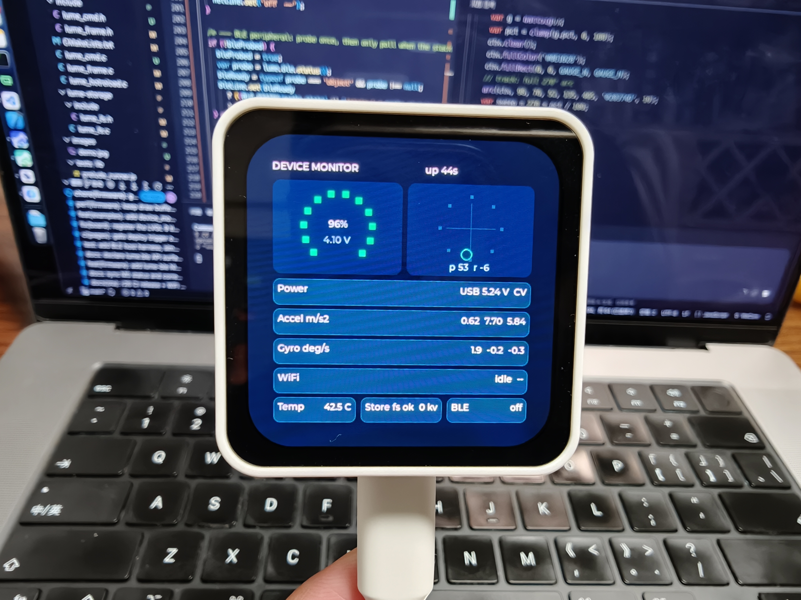
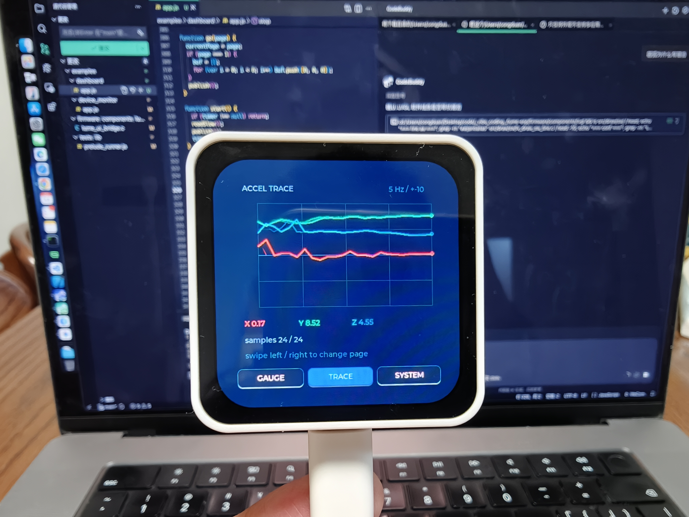
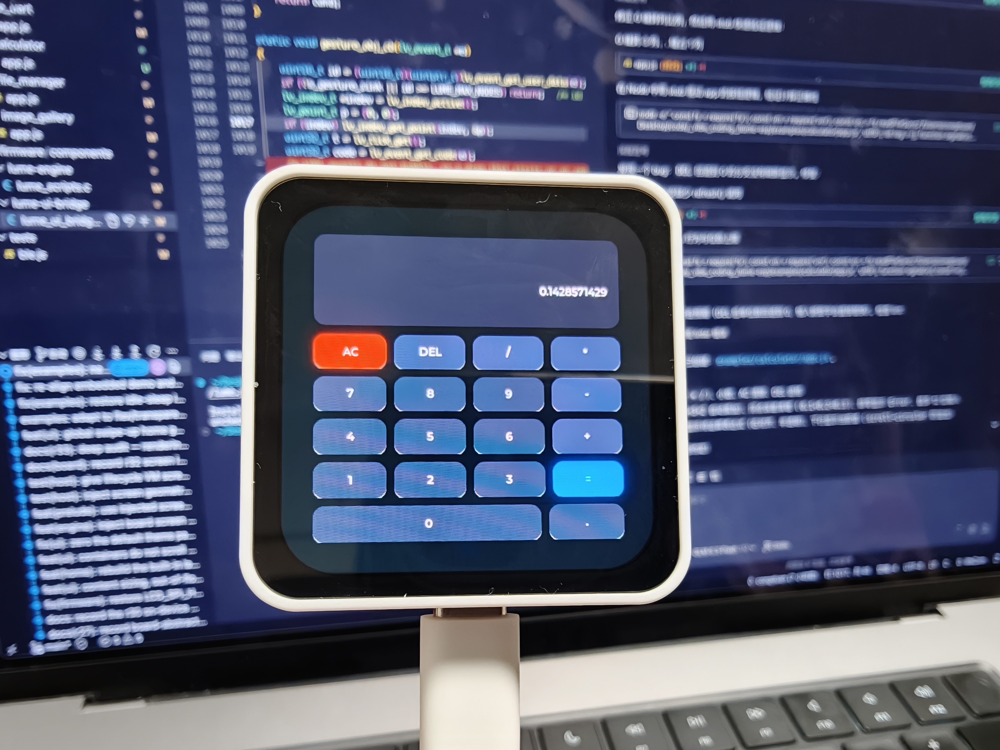

</div>

---

## Screenshots

Real firmware, no mockups. The showcase images below are rendered by the
[esp32sim](https://github.com/mikroverk/esp32sim) board emulator and captured automatically in CI;
the launcher image is a `lume screenshot` frame read back from the physical board over USB.
Every image is 480×480, the actual panel size.

**On the board** — captured from the device, not the emulator:

| |
|:--:|
| 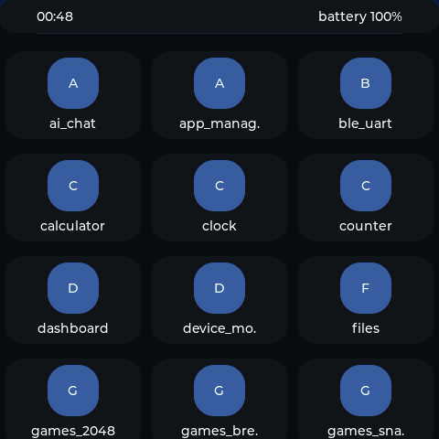<br>**Built-in launcher**<br><sub>15 installed apps, EDIT uninstall mode</sub> |

What this frame shows, exactly: the home screen is the JS bundled in
[`lume_scripts.c`](firmware/components/lume-engine/lume_scripts.c) (`lume_home_js`). Tiles carry the
first letter of each app's label (`glyphOf`) on a rounded card, names longer than the tile are
clipped with a trailing dot (`clip()`), so `device_monitor` reads `device_mo.`, and the
3-column grid scrolls past the 12 tiles visible here. The status bar is clock / wifi / battery:
wifi is blank, the battery reports `100%`, and the clock reads `00:48` because the RTC on this
unit was not synced.

**Apps**

| | | |
|:--:|:--:|:--:|
| 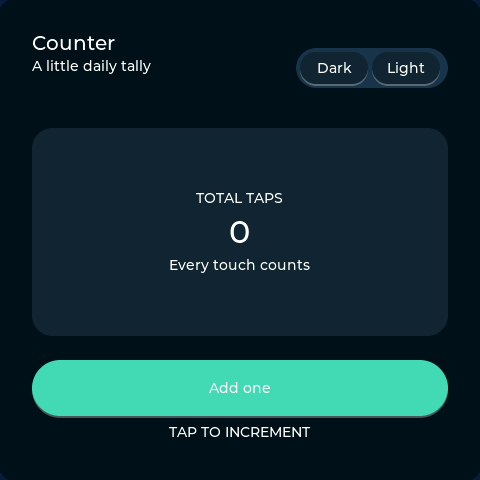<br>**Counter**<br><sub>signals + theme switching</sub> | 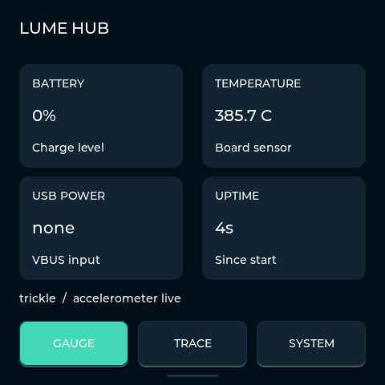<br>**Dashboard**<br><sub>card grid, live telemetry</sub> | 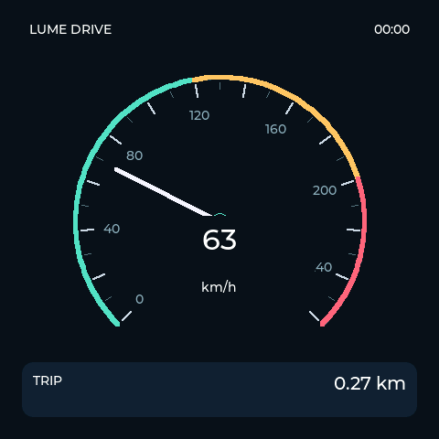<br>**Speedometer**<br><sub>270° arc dial, needle tweening</sub> |
| 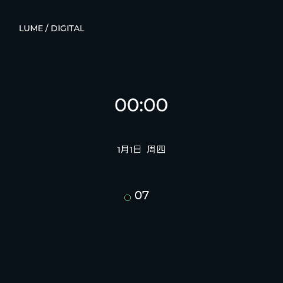<br>**Watch faces**<br><sub>five switchable styles</sub> | 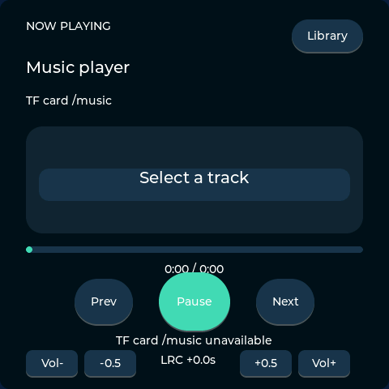<br>**Music player**<br><sub>MP3 from TF card + synced LRC</sub> | 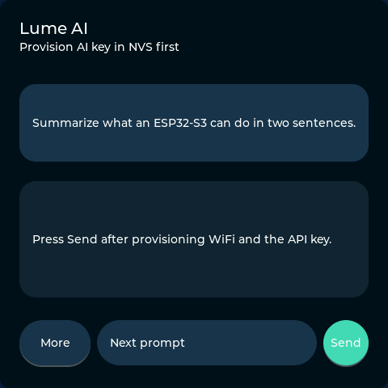<br>**AI chat**<br><sub>LLM over WiFi, chat bubbles</sub> |
| 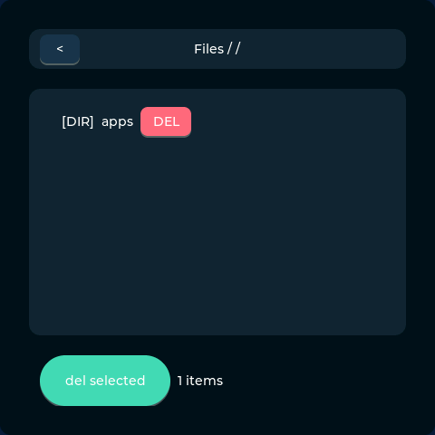<br>**File manager**<br><sub>virtualized list, dialogs</sub> | 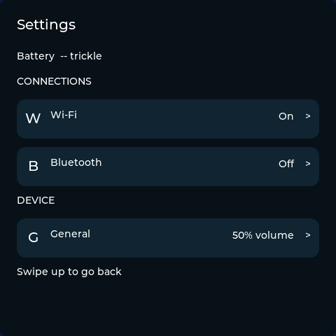<br>**Settings**<br><sub>grouped list, WiFi/BT/audio</sub> | 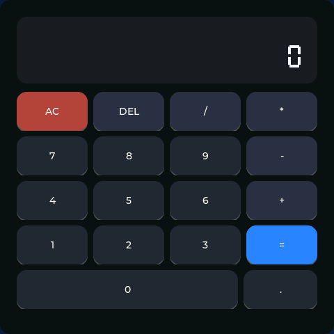<br>**Calculator**<br><sub>seven-segment display</sub> |
| 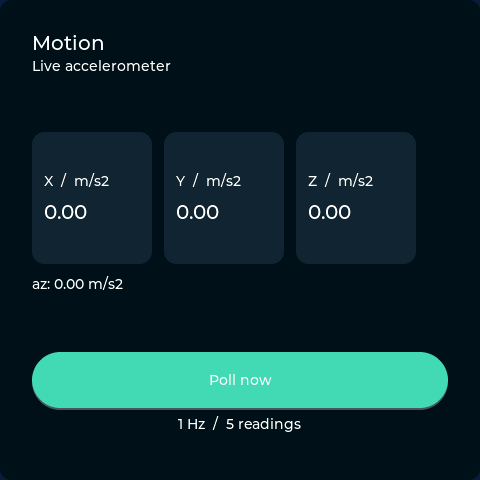<br>**IMU**<br><sub>sensor cards, 20 Hz polling</sub> | 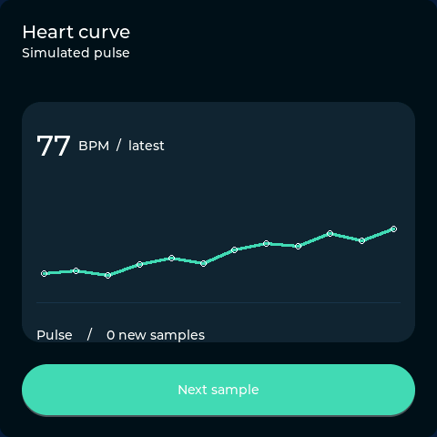<br>**Heart curve**<br><sub>Canvas polyline plotting</sub> | 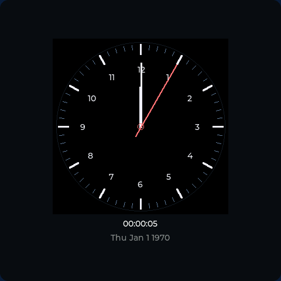<br>**Clock**<br><sub>frames, timers, lifecycle</sub> |
| 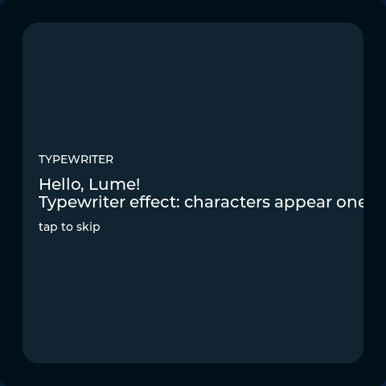<br>**Typewriter**<br><sub>per-character reveal + blinking cursor</sub> | 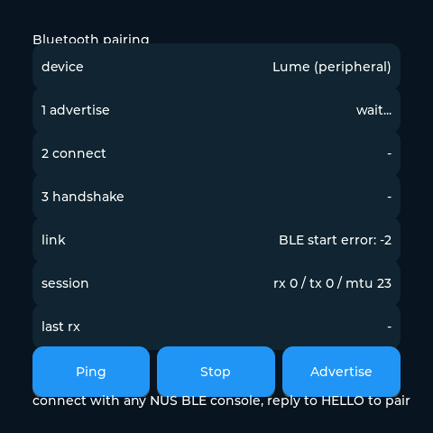<br>**BLE UART**<br><sub>scan, connect, echo terminal</sub> | 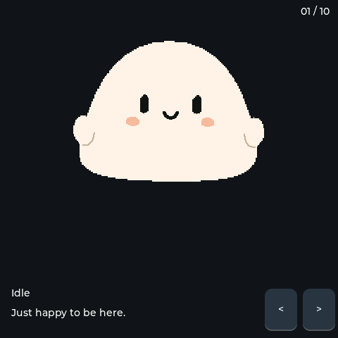<br>**Mochi**<br><sub>gesture toy</sub> |

**Games** (ESP32-S3 + single-point touch + IMU)

| | | | | | |
|:--:|:--:|:--:|:--:|:--:|:--:|
| 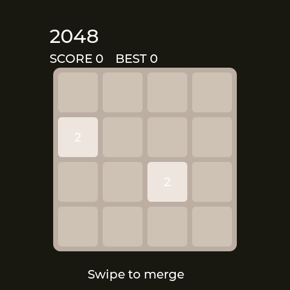<br>**2048**<br><sub>swipe + merge</sub> | 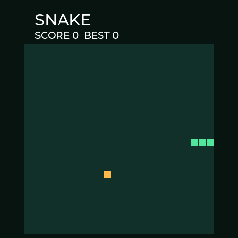<br>**Snake**<br><sub>tilt or swipe steering</sub> | 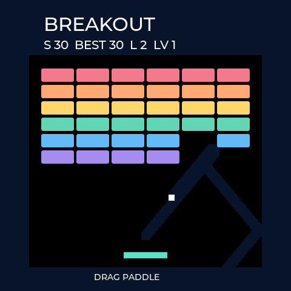<br>**Breakout**<br><sub>touch paddle, 6 levels</sub> | 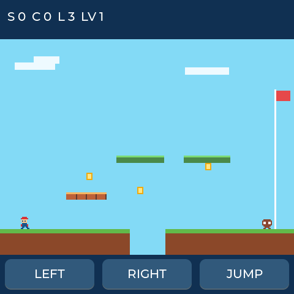<br>**Mario**<br><sub>pixel-sprite platformer, coins & enemies</sub> | 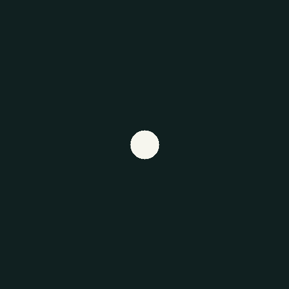<br>**Gravity ball**<br><sub>IMU tilt physics, dirty-rect rendering</sub> | 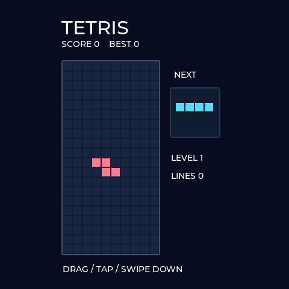<br>**Tetris**<br><sub>pan, rotate, drop</sub> |

**Shell components** ([runtime/shell.js](runtime/shell.js) — status bar, launcher, dialogs, toasts)

The optional [launcher app](examples/launcher/app.js) can pin itself as the
power-on target with `lume.apps.setBoot('launcher')`. Its **EDIT → EXIT LAUNCHER
MODE** action clears the pin and opens the built-in home grid. Without a pin,
the device boots the last successfully launched app as before. Launching a
different app does not clear the pin; a direct TF/CLI pin editor is pending.

| | | |
|:--:|:--:|:--:|
| 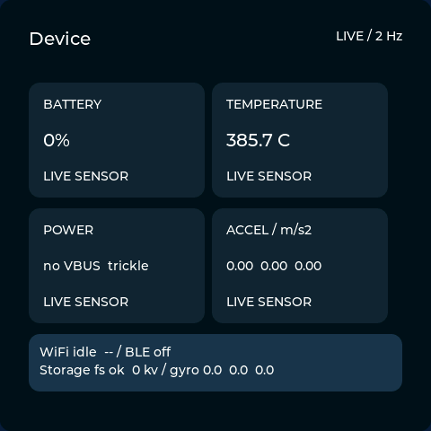<br>**Device monitor**<br><sub>PMIC / IMU / radio telemetry gauges</sub> | 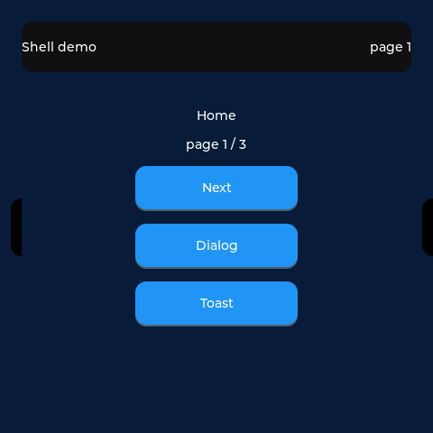<br>**Dialog + Toast**<br><sub>overlays, modal touch blocking</sub> | 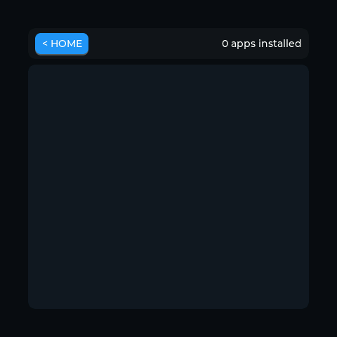<br>**App manager**<br><sub>install / launch / remove</sub> |

<sub>Design rules behind these screens: [docs/ui-guidelines.md](docs/ui-guidelines.md) — 24 px gutter,
4/8/12/16/24/32 spacing scale, display/title/body/caption/micro type ramp, ≥56 px touch targets,
card-first layout. Layout geometry is asserted pixel-by-pixel by
[tools/emu/check_layout.py](tools/emu/check_layout.py) in CI.</sub>

---

## Why Lume

Traditional embedded UI development on the ESP32-S3 looks like this: C/C++, a full
rebuild-and-flash cycle for every change, and an imperative UI API (LVGL) where every
widget is created, styled, positioned, and destroyed by hand.

Lume replaces that loop:

| | Traditional (C + LVGL) | Lume |
|---|---|---|
| Language | C/C++ | **JavaScript / TypeScript** |
| UI style | Imperative widget tree | **Declarative + signals (state → view)** |
| Layout | Manual coordinate math | **CSS-style flex (column/row/justify/gap/padding/%)** |
| Custom visuals | Custom C drawing code | **Canvas widget with a JS drawing context** |
| Motion | Hand-tuned lv_anim calls | **CSS-style transitions + `lume.anim` tweens** |
| Iteration | Rebuild + flash (minutes) | **Hot reload over USB (seconds)** + host simulator + on-device screenshots (`lume screenshot`) |
| Hardware access | ESP-IDF APIs | **Clean JS APIs: GPIO/PWM/ADC/Power/IMU/Audio/WiFi/HTTP/KV/Files** |
| Runtime overhead | none | QuickJS-NG on 8MB PSRAM — fine for app-layer UI |

## Architecture

```
┌────────────────────────────────────────────────────┐
│  Your app — pure JS/TS                             │
│    declarative UI (signals → view)                 │
│    hardware APIs (gpio/imu/audio/power/net/storage)│
├────────────────────────────────────────────────────┤
│  Lume runtime (C, ESP-IDF components)              │
│    QuickJS-NG engine (PSRAM heap, event loop)      │
│    signals prelude · declarative → LVGL bridge     │
│    lifecycle · themes · gestures · animations      │
│    push channel: USB serial + WiFi TCP (apps,      │
│    commands, screenshots)                          │
├────────────────────────────────────────────────────┤
│  LVGL (render backend, hidden) · ESP-IDF           │
│    CO5300 QSPI AMOLED · CST9220 touch · AXP2101    │
│    QMI8658 IMU · ES8311/ES7210 audio · WiFi · TF   │
└────────────────────────────────────────────────────┘
```

LVGL never leaks into app code. It is a rendering backend, the way UIKit sits behind
React Native.

## Quick Start

With Node.js 18+ and Lume firmware on the board:

```bash
npm ci --prefix tools/lume
node tools/lume/lume.js create my-app
node tools/lume/lume.js dev my-app
```

`node tools/lume/lume.js check examples/counter` verifies an app in one command (bundle +
emulator eval + layout R1–R7 + perf summary, `--json` for machine-readable output, exit
0/1 for CI and agents); see [one-command verification](docs/build.md#one-command-verification-lume-check).

Edit `my-app/app.js` to see each saved change on screen. Use `--port /dev/ttyACM0` if the
USB Serial/JTAG port is not detected automatically. For a one-time push, run
`node tools/lume/lume.js deploy my-app`. Once the board is on WiFi, the same bundle can be
pushed over TCP with `node tools/lume/lume.js deploy my-app --ota <ip> --token <t>` (the
token is printed on the device serial log at boot; `--ota-port` selects a non-default port).
To capture what the board is actually showing, run `node tools/lume/lume.js screenshot
shot.bmp` — the frame comes back over the same USB/WiFi channel as a CRC-checked
480×480 RGB565 snapshot and is written as a BMP (works with `--ota` too; see
[debug screenshot](docs/build.md#debug-screenshot-lume-screenshot)).
See [build and development](docs/build.md) for protocol details, controls, and the WiFi OTA /
CI release notes.

### Try it in your browser

Open the [static Playground](https://congduan.github.io/lume-esp/playground/) to try 16 screen apps without installing anything. It is a prelude semantic simulation with stubbed hardware APIs; touch feel, timing, and hardware behavior still require a real board.

### Host Simulator

Preview without a board: `node tools/simulator/sim.js examples/counter/app.js`, then open
`http://localhost:8765`. Created projects can use `npm run sim` while this repository
checkout is available. The browser replays prelude UI messages, updates on save, and sends
button clicks back to the app. Final visual and performance checks still need the device;
see [simulator details](docs/build.md#host-simulator).

## Examples

### 1. Hello Lume — signals-driven counter

The "hello world" that proves the whole loop: touch → signal → screen.

```js
const count = signal(0);

View({ style: {
  display: 'flex', flexDirection: 'column',
  justifyContent: 'center', alignItems: 'center',
  width: '100%', height: '100%', gap: 16,
  background: '#0B1E3F', borderRadius: 12,
}}, [
  Text({ text: () => 'taps: ' + count(), style: { color: '#FFFFFF' } }),
  Button({ title: '+1', onPress: () => count.set(count() + 1) }),
]);
```

No `setState`, no re-render, no diff on the hot path: `count.set()` flows straight
into a native text update. Signals connect reactive values to on-screen attributes
directly.

### 2. Device monitor — live hardware telemetry

Canvas gauges plus reactive text, driven by the `lume.*` hardware APIs:

```js
var battGauge = Canvas({ width: 196, height: 140, onDraw: function (ctx) {
  var pct = clamp(battPct(), 0, 100);
  gaugeFrame(ctx, 196, 140);
  var lit = Math.round(12 * pct / 100);
  /* 12-segment dial: dim dots for the unlit segments, colored when lit */
  ...
  ctx.text(84, 56, Math.round(pct) + '%', monitorTheme.colors.text, 14);
  ctx.text(76, 80, battVolts(), monitorTheme.colors.textDim, 14);
} });

Text({ text: function () { return 'WiFi ' + netLine() + ' / BLE ' + bleLine(); } });
```

Battery / charger state, die temperature, IMU tilt, WiFi/BLE and storage — all read
through `lume.pmic` / `lume.imu` / `lume.net` and pushed into signals at 2 Hz.
Full source: [examples/device_monitor/app.js](examples/device_monitor/app.js).

### 3. Files — a complete file manager app

TF-card directory browsing with the Fs API: create a folder, preview a text file,
delete with confirmation, virtualized `List` whose rows keep the name on the left and
the row action on the right, lifecycle-aware refresh.

```js
function loadDir(path) {
  const clean = path.replace(/\/+$/, '') || '/';   // LittleFS rejects a trailing '/'
  const list = Fs.list(clean);
  if (typeof list === 'number') { notify('Read failed: ' + list); return; }
  entries.set(list.map(name => ({ name: name, isDir: isDirPath(path + name) })));
  cwd.set(clean === '/' ? '/' : clean + '/');
}
```

Full source: [examples/files/app.js](examples/files/app.js).

### 4. Hardware one-liners

```js
// Battery telemetry → UI
Text({ text: () => 'battery: ' + lume.pmic.battPercent() + '%' });

// IMU tilt → gravity direction for the app (m/s²)
const s = lume.imu.read();            // { ax, ay, az, gx, gy, gz } | null

// Voice memo: mic → PSRAM → TF card → speaker
const clip = lume.audio.record(5);
if (typeof clip !== 'number') {
  lume.storage.Fs.write('/memo.pcm', clip);
  lume.audio.play(lume.storage.Fs.readBinary('/memo.pcm'));
}

// WiFi + HTTP
lume.net.connect('SSID', 'password');
const res = lume.net.httpGet('http://api.example.com/weather');

// BLE peripheral (NimBLE, Nordic UART Service shape) — poll, no callbacks
lume.ble.start('Lume');
lume.system.setInterval(() => {
  const msg = lume.ble.read();   // string | null (empty) | negative error code
  if (typeof msg === 'string') lume.ble.write('echo:' + msg.slice(0, 12));
}, 100);

// Settings that survive power loss
lume.storage.kv.set('brightness', 70);

// Auto-sleep with touch wake
lume.power.sleepNow();                // touch the screen to wake up
```

All hardware namespaces follow the same contract: `0` = success, negative = error
code, and every failure mode is documented in [`runtime/types/lume.d.ts`](runtime/types/lume.d.ts).

## Feature highlights

- **Signals reactivity** — value changes flow straight to on-screen attributes; no VDOM
  diff on the hot path ([design notes](docs/reactivity-design.md))
- **CSS-style flex layout** — flexDirection/justifyContent/alignItems/gap/padding and
  percentage sizing, mapped to LVGL flex under the hood
- **Canvas** — JS drawing context (rects/lines/circles/text) inside the flex layout,
  signal-driven repaint, PSRAM-backed buffer
- **Animations** — CSS-style `transition` on signal-bound attributes plus imperative
  `lume.anim.to()` tweens with completion callbacks
- **Gestures** — tap / swipe / longpress / pan streams with scroll coexistence
- **Lifecycle** — onStart/onPause/onResume/onBack; bundles are fully disposed on hot reload
- **Themes** — named color tokens, one-call dark/light switch that repaints referenced attrs
- **Auto-sleep** — idle timeout into light sleep, touch wakes the screen (ext0 on the
  touch INT pin)
- **Screenshot debugging** — `lume screenshot` grabs the live panel frame over the
  same USB/WiFi push channel and writes a CRC-verified BMP, no extra tooling

## Hardware target

First-class board support:

- **Waveshare ESP32-S3-Touch-AMOLED-2.16** (ESP32-S3, 16MB flash, 8MB PSRAM,
  2.16" 480×480 QSPI AMOLED CO5300, CST9220 touch, AXP2101 PMIC, QMI8658 IMU,
  ES8311 codec + ES7210 mic, 32GB TF card over SPI)

Board support currently targets the Waveshare ESP32-S3-Touch-AMOLED-2.16 only;
a board abstraction layer for additional targets is not implemented yet.

## Status

Active development — M1/M2/M3 code complete; M4 tooling and the first M5 shell
components are in progress.

| Milestone | State |
|---|---|
| **M1 — minimal loop** (engine, touch→JS, declarative UI, hot reload) | ✅ code complete |
| **M2 — hardware API surface** (GPIO/PWM/ADC, power, IMU, WiFi+HTTP, KV, files, audio) | ✅ code complete |
| **M3 — declarative UI completeness** (flex, styles, animation, canvas, gestures, lifecycle, themes, virtualized lists, images) | ✅ code complete |
| **M4 — tooling** (`lume` CLI ✅, host simulator ✅, WiFi OTA code complete / board check pending) | 🚧 |
| **M5 — ecosystem** (component library, launcher shell, board abstraction) | 🚧 optional JS shell components + bilingual docs site landed; board abstraction not started |

> **Honesty note**: "code complete" means compiles green, host-tested, and reviewed.
> On-device acceptance (visuals, touch feel, sleep current, radio range) is pending
> board bring-up and tracked per-item in [docs/roadmap.md](docs/roadmap.md).

Documentation: [docs/roadmap.md](docs/roadmap.md) ·
[reactivity design](docs/reactivity-design.md) ·
[hardware API contract](docs/hardware-api.md) ·
[known simplifications](docs/KNOWN-SIMPLIFICATIONS.md)

## License

MIT
