<div align="center">

# Lume

[English](README.md) | **简体中文**

**用 JavaScript 编写整块 ESP32-S3 AMOLED 应用。不需要 C，不需要反复重建，开发者侧也没有沉重框架。**

*声明式 UI · Signals 响应式 · Flex 布局 · Canvas · 动画 · 手势 · 主题 · 热重载 · 完整硬件访问 —— 底层由 QuickJS-NG + LVGL 驱动*

> **目标**：把最现代的前端技术（声明式组件、signals 响应式、flex 布局、canvas、动画、热重载、TypeScript 工具链）带到 ESP32 —— 用**尽可能少**的设备资源（QuickJS 字节码、LVGL 脏矩形渲染、PSRAM 托管的堆），换来**尽可能好**的嵌入式开发体验（改动几秒可见，应用开发者的机器上零 C 工具链）。

🌐 **[在线文档站](https://congduan.github.io/lume-esp/)** —— API 参考、示例画廊、FAQ（中英双语）

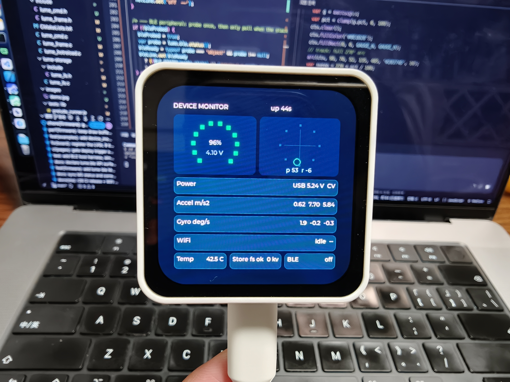
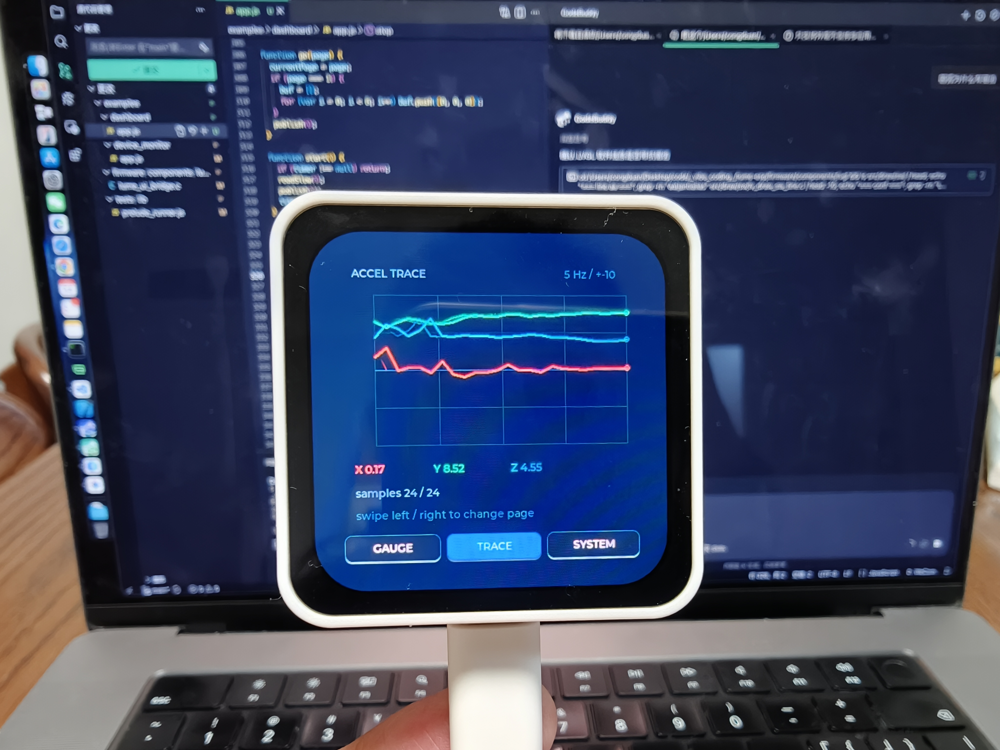
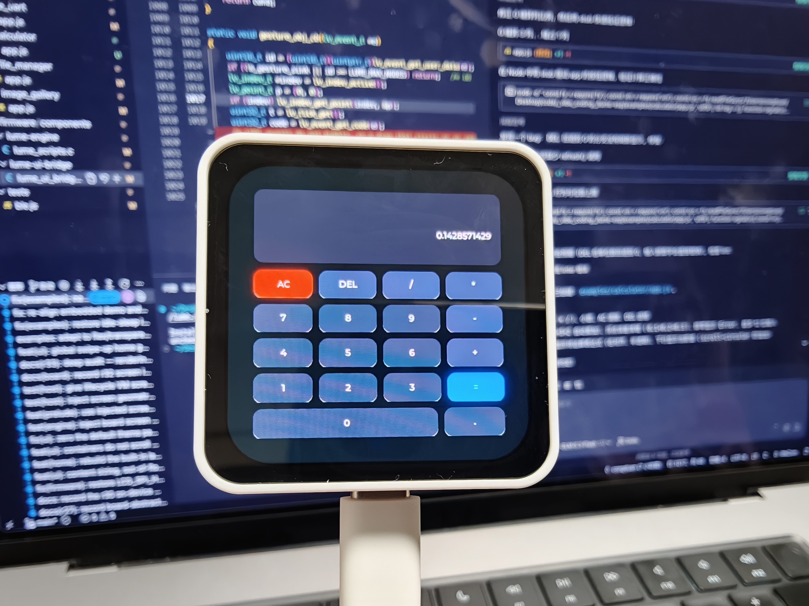

</div>

---

## 截图

真实固件，不是效果图。下面的展示图由 [esp32sim](https://github.com/mikroverk/esp32sim) 板级模拟器渲染、
CI 自动截取；启动器那张是 `lume screenshot` 通过 USB 从实体板子读回的画面。所有图片都是 480×480，
即实际屏幕尺寸。

**真机画面** —— 从设备抓取，不是模拟器：

| |
|:--:|
| 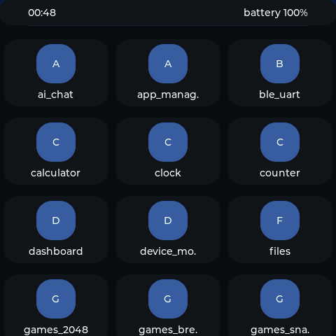<br>**内置启动器**<br><sub>15 个已安装应用、EDIT 卸载模式</sub> |

这张图具体反映的内容：桌面就是
[`lume_scripts.c`](firmware/components/lume-engine/lume_scripts.c) 里内嵌的 JS（`lume_home_js`）。卡片上每个
图标取应用名的首字母（`glyphOf`），名字超出卡片宽度时由 `clip()` 截断并补一个点，所以 `device_monitor`
显示为 `device_mo.`；3 列网格可滚动，图中可见 12 个卡片。状态栏依次是时钟 / wifi / 电量：wifi 为空，
电量显示 `100%`，时钟显示 `00:48` 是因为这台机器的 RTC 没有同步。

**应用**

| | | |
|:--:|:--:|:--:|
| 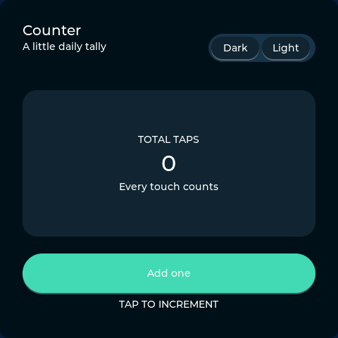<br>**计数器**<br><sub>signals + 主题切换</sub> | 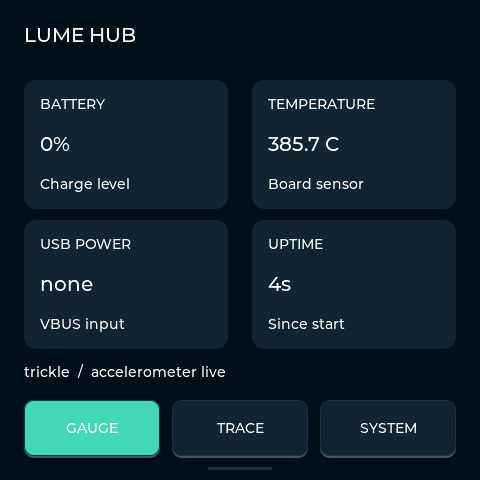<br>**仪表盘**<br><sub>卡片网格、实时遥测</sub> | 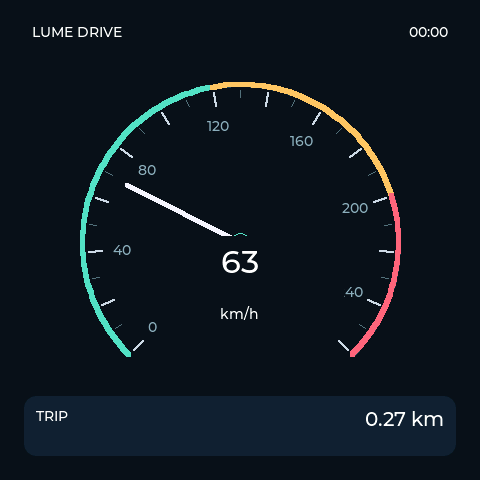<br>**速度表**<br><sub>270° 弧线表盘、指针补间</sub> |
| 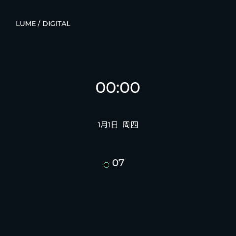<br>**表盘**<br><sub>三种可切换风格</sub> | 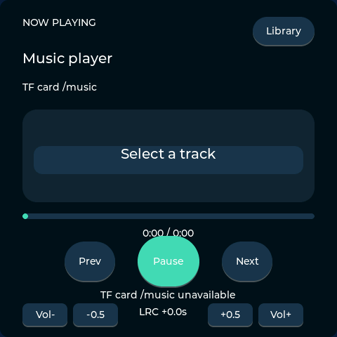<br>**音乐播放器**<br><sub>TF 卡 MP3 + 同步歌词</sub> | 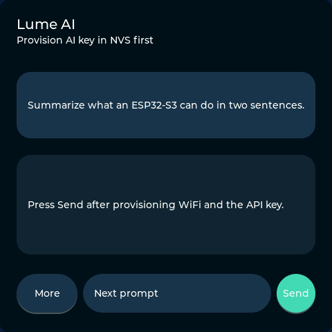<br>**AI 对话**<br><sub>WiFi 接入大模型、聊天气泡</sub> |
| 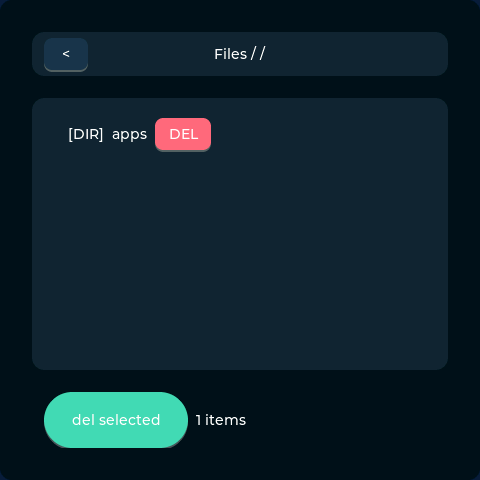<br>**文件管理器**<br><sub>虚拟化列表、对话框</sub> | 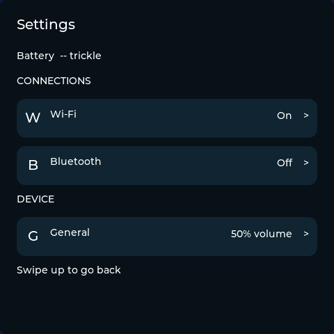<br>**设置**<br><sub>分组列表、WiFi/蓝牙/音频</sub> | 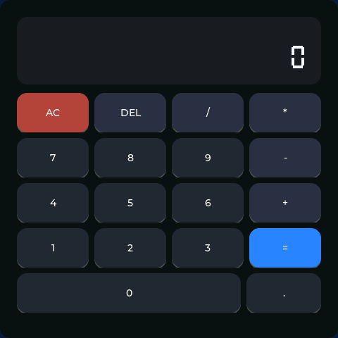<br>**计算器**<br><sub>七段数码管显示</sub> |
| 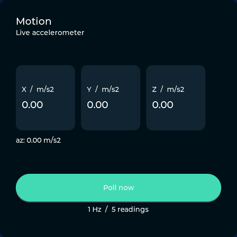<br>**IMU**<br><sub>传感器卡片、20 Hz 轮询</sub> | 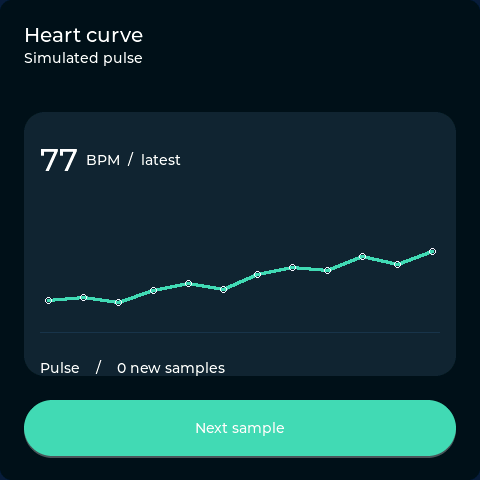<br>**心形曲线**<br><sub>Canvas 折线绘制</sub> | 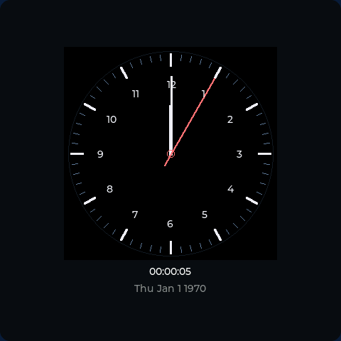<br>**时钟**<br><sub>帧、定时器、生命周期</sub> |

**游戏**（ESP32-S3 + 单点触摸 + IMU）

| | | |
|:--:|:--:|:--:|
| 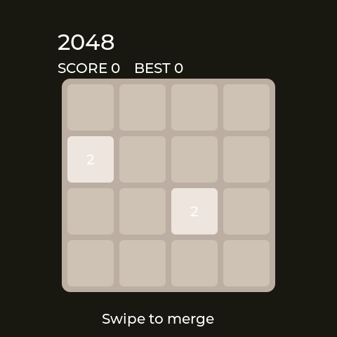<br>**2048**<br><sub>滑动 + 合并</sub> | 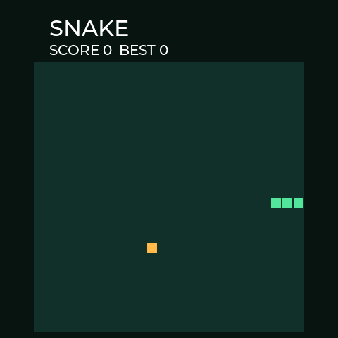<br>**贪吃蛇**<br><sub>倾斜或滑动操控</sub> | 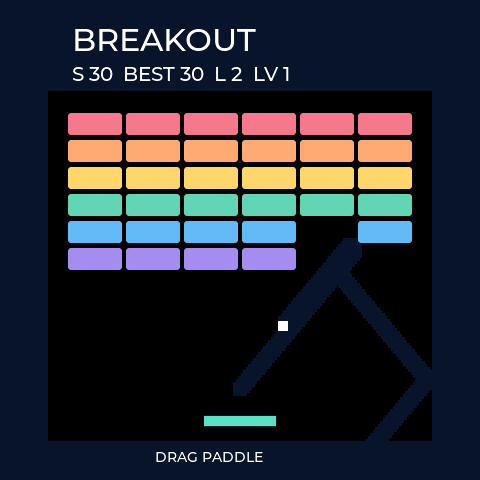<br>**打砖块**<br><sub>触摸挡板、6 关</sub> |

**壳层组件**（[runtime/shell.js](runtime/shell.js) —— 状态栏、启动器、对话框、Toast）

| | | |
|:--:|:--:|:--:|
| 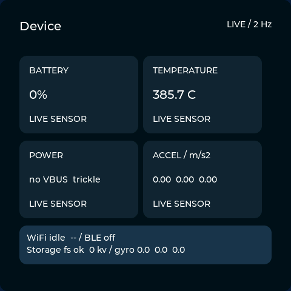<br>**设备监控**<br><sub>PMIC / IMU / 射频遥测表盘</sub> | 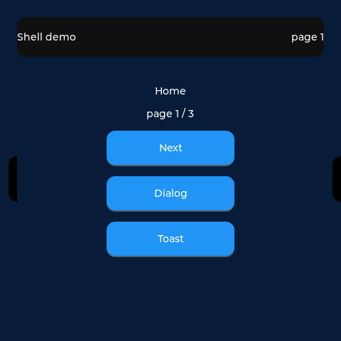<br>**对话框 + Toast**<br><sub>浮层、模态触摸拦截</sub> | 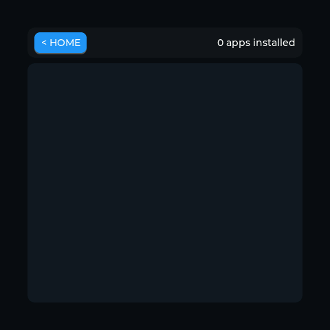<br>**应用管理**<br><sub>安装 / 启动 / 卸载</sub> |

<sub>这些界面遵循的设计规则：[docs/ui-guidelines.md](docs/ui-guidelines.md) —— 24 px 边距、
4/8/12/16/24/32 间距刻度、display/title/body/caption/micro 字号梯度、≥56 px 触摸目标、
卡片优先布局。布局几何由 [tools/emu/check_layout.py](tools/emu/check_layout.py) 在 CI 中逐像素断言。</sub>

---

## 为什么是 Lume

ESP32-S3 上传统的嵌入式 UI 开发是这样的：C/C++，每次改动都要完整重建 + 烧录，
以及一套命令式 UI API（LVGL）——每个控件都要手工创建、设样式、定位、销毁。

Lume 换掉了这整套循环：

| | 传统方式（C + LVGL） | Lume |
|---|---|---|
| 语言 | C/C++ | **JavaScript / TypeScript** |
| UI 风格 | 命令式控件树 | **声明式 + signals（状态 → 视图）** |
| 布局 | 手工坐标计算 | **CSS 风格 flex（column/row/justify/gap/padding/%）** |
| 自定义视觉 | 手写 C 绘图代码 | **带 JS 绘图上下文的 Canvas 组件** |
| 动效 | 手调 lv_anim 调用 | **CSS 风格 transition + `lume.anim` 补间** |
| 迭代 | 重建 + 烧录（分钟级） | **USB 热重载（秒级）** + 宿主模拟器 + 真机截图（`lume screenshot`） |
| 硬件访问 | ESP-IDF API | **简洁的 JS API：GPIO/PWM/ADC/Power/IMU/Audio/WiFi/HTTP/KV/Files** |
| 运行时开销 | 无 | 8MB PSRAM 上的 QuickJS-NG —— 对应用层 UI 完全够用 |

## 架构

```
┌────────────────────────────────────────────────────┐
│  你的应用 —— 纯 JS/TS                              │
│    声明式 UI（signals → 视图）                     │
│    硬件 API（gpio/imu/audio/power/net/storage）    │
├────────────────────────────────────────────────────┤
│  Lume 运行时（C，ESP-IDF 组件）                    │
│    QuickJS-NG 引擎（PSRAM 堆、事件循环）           │
│    signals prelude · 声明式 → LVGL 桥              │
│    生命周期 · 主题 · 手势 · 动画                   │
│    推送通道：USB 串口 + WiFi TCP（应用、            │
│    命令、截图）                                    │
├────────────────────────────────────────────────────┤
│  LVGL（渲染后端，对应用隐藏）· ESP-IDF             │
│    CO5300 QSPI AMOLED · CST9220 触摸 · AXP2101    │
│    QMI8658 IMU · ES8311/ES7210 音频 · WiFi · TF    │
└────────────────────────────────────────────────────┘
```

LVGL 永远不会漏进应用代码。它只是渲染后端，就像 React Native 背后的 UIKit。

## 快速开始

需要 Node.js 18+，并且板子上已烧录 Lume 固件：

```bash
npm ci --prefix tools/lume
node tools/lume/lume.js create my-app
node tools/lume/lume.js dev my-app
```

编辑 `my-app/app.js`，每次保存都能在屏幕上看到变化。如果 USB Serial/JTAG 口没有自动识别，
用 `--port /dev/ttyACM0`。一次性推送用 `node tools/lume/lume.js deploy my-app`。板子接入
WiFi 后，同一个 bundle 也能走 TCP：`node tools/lume/lume.js deploy my-app --ota <ip> --token <t>`
（token 在设备启动时的串口日志里打印；`--ota-port` 用于指定非默认端口）。
想抓取板子当前真正显示的画面，运行 `node tools/lume/lume.js screenshot shot.bmp` ——
画面通过与 USB/WiFi 相同的通道、以 CRC 校验的 480×480 RGB565 快照返回，并写成一个 BMP
（`--ota` 同样可用；见[调试截图](docs/build.md#debug-screenshot-lume-screenshot)）。
协议细节、控制键与 WiFi OTA / CI 发布说明见[构建与开发](docs/build.md)。

### 宿主模拟器

不接板子也能预览：`node tools/simulator/sim.js examples/counter/app.js`，然后打开
`http://localhost:8765`。在本仓库检出可用的情况下，新建项目可以直接跑 `npm run sim`。
浏览器会重放 prelude 的 UI 消息、保存即更新，并把按钮点击回传给应用。
最终的视觉与性能验证仍然要在真机上做；见[模拟器细节](docs/build.md#host-simulator)。

## 示例

### 1. Hello Lume —— signals 驱动的计数器

证明整条链路的 “hello world”：触摸 → signal → 屏幕。

```js
const count = signal(0);

View({ style: {
  display: 'flex', flexDirection: 'column',
  justifyContent: 'center', alignItems: 'center',
  width: '100%', height: '100%', gap: 16,
  background: '#0B1E3F', borderRadius: 12,
}}, [
  Text({ text: () => 'taps: ' + count(), style: { color: '#FFFFFF' } }),
  Button({ title: '+1', onPress: () => count.set(count() + 1) }),
]);
```

没有 `setState`，没有重新渲染，热路径上也没有 diff：`count.set()` 直接流入一次原生文本更新。
signals 把响应式值直接连到屏幕上的属性。

### 2. 设备监控 —— 实时硬件遥测

Canvas 表盘加响应式文本，由 `lume.*` 硬件 API 驱动：

```js
var battGauge = Canvas({ width: 196, height: 140, onDraw: function (ctx) {
  var pct = clamp(battPct(), 0, 100);
  gaugeFrame(ctx, 196, 140);
  var lit = Math.round(12 * pct / 100);
  /* 12-segment dial: dim dots for the unlit segments, colored when lit */
  ...
  ctx.text(84, 56, Math.round(pct) + '%', monitorTheme.colors.text, 14);
  ctx.text(76, 80, battVolts(), monitorTheme.colors.textDim, 14);
} });

Text({ text: function () { return 'WiFi ' + netLine() + ' / BLE ' + bleLine(); } });
```

电池/充电状态、芯片温度、IMU 倾斜、WiFi/BLE 与存储 —— 全部通过 `lume.pmic` / `lume.imu` /
`lume.net` 读取，并以 2 Hz 推进 signals。完整源码：
[examples/device_monitor/app.js](examples/device_monitor/app.js)。

### 3. Files —— 一个完整的文件管理器应用

用 Fs API 浏览 TF 卡目录：新建文件夹、预览文本文件、确认后删除、虚拟化 `List`
（每行左侧是文件名、右侧是行操作）、感知生命周期的刷新。

```js
function loadDir(path) {
  const clean = path.replace(/\/+$/, '') || '/';   // LittleFS rejects a trailing '/'
  const list = Fs.list(clean);
  if (typeof list === 'number') { notify('Read failed: ' + list); return; }
  entries.set(list.map(name => ({ name: name, isDir: isDirPath(path + name) })));
  cwd.set(clean === '/' ? '/' : clean + '/');
}
```

完整源码：[examples/files/app.js](examples/files/app.js)。

### 4. 硬件一行代码

```js
// Battery telemetry → UI
Text({ text: () => 'battery: ' + lume.pmic.battPercent() + '%' });

// IMU tilt → gravity direction for the app (m/s²)
const s = lume.imu.read();            // { ax, ay, az, gx, gy, gz } | null

// Voice memo: mic → PSRAM → TF card → speaker
const clip = lume.audio.record(5);
if (typeof clip !== 'number') {
  lume.storage.Fs.write('/memo.pcm', clip);
  lume.audio.play(lume.storage.Fs.readBinary('/memo.pcm'));
}

// WiFi + HTTP
lume.net.connect('SSID', 'password');
const res = lume.net.httpGet('http://api.example.com/weather');

// BLE peripheral (NimBLE, Nordic UART Service shape) — poll, no callbacks
lume.ble.start('Lume');
lume.system.setInterval(() => {
  const msg = lume.ble.read();   // string | null (empty) | negative error code
  if (typeof msg === 'string') lume.ble.write('echo:' + msg.slice(0, 12));
}, 100);

// Settings that survive power loss
lume.storage.kv.set('brightness', 70);

// Auto-sleep with touch wake
lume.power.sleepNow();                // touch the screen to wake up
```

所有硬件命名空间遵循同一套契约：`0` = 成功，负数 = 错误码，每种失败模式都记录在
[`runtime/types/lume.d.ts`](runtime/types/lume.d.ts) 里。

## 特性一览

- **Signals 响应式** —— 值变化直接流到屏幕属性，热路径上没有 VDOM diff
  （[设计说明](docs/reactivity-design.md)）
- **CSS 风格 flex 布局** —— flexDirection/justifyContent/alignItems/gap/padding 与百分比尺寸，
  底层映射到 LVGL flex
- **Canvas** —— flex 布局里的 JS 绘图上下文（矩形/线/圆/文本），signal 驱动重绘，
  PSRAM 托管的缓冲区
- **动画** —— 绑定 signal 的属性支持 CSS 风格 `transition`，另有命令式 `lume.anim.to()`
  补间与完成回调
- **手势** —— tap / swipe / longpress / pan 事件流，与滚动共存
- **生命周期** —— onStart/onPause/onResume/onBack；热重载时 bundle 被完整释放
- **主题** —— 具名颜色 token，一次调用切换明暗并重绘引用到的属性
- **自动息屏** —— 空闲超时进入 light sleep，触摸唤醒（触摸 INT 引脚上的 ext0）
- **截图调试** —— `lume screenshot` 通过同一条 USB/WiFi 推送通道抓取实时画面并写成
  经 CRC 校验的 BMP，不需要额外工具

## 硬件目标

一等支持：

- **Waveshare ESP32-S3-Touch-AMOLED-2.16**（ESP32-S3，16MB flash，8MB PSRAM，
  2.16" 480×480 QSPI AMOLED CO5300，CST9220 触摸，AXP2101 PMIC，QMI8658 IMU，
  ES8311 codec + ES7210 麦克风，SPI 接口 32GB TF 卡）

目前板级支持面向 Waveshare ESP32-S3-Touch-AMOLED-2.16；面向更多目标的板抽象层尚未实现。

## 状态

活跃开发中 —— M1/M2/M3 代码完成；M4 工具链与首批 M5 壳层组件进行中。

| 里程碑 | 状态 |
|---|---|
| **M1 —— 最小闭环**（引擎、触摸→JS、声明式 UI、热重载） | ✅ 代码完成 |
| **M2 —— 硬件 API 面**（GPIO/PWM/ADC、电源、IMU、WiFi+HTTP、KV、文件、音频） | ✅ 代码完成 |
| **M3 —— 声明式 UI 完整性**（flex、样式、动画、canvas、手势、生命周期、主题、虚拟化列表、图片） | ✅ 代码完成 |
| **M4 —— 工具链**（`lume` CLI ✅、宿主模拟器 ✅、WiFi OTA 代码完成 / 待真机确认） | 🚧 |
| **M5 —— 生态**（组件库、启动器壳层、板抽象） | 🚧 可选的 JS 壳层组件与双语文档站已落地；板抽象未开始 |

> **如实说明**：“代码完成”意味着编译通过、宿主测试通过并已复审。真机验收（视觉、触摸手感、
> 睡眠电流、射频距离）仍待接板，逐项跟踪在 [docs/roadmap.md](docs/roadmap.md)。

文档：[docs/roadmap.md](docs/roadmap.md) ·
[响应式设计](docs/reactivity-design.md) ·
[硬件 API 契约](docs/hardware-api.md) ·
[已知简化](docs/KNOWN-SIMPLIFICATIONS.md)

## 许可

MIT
