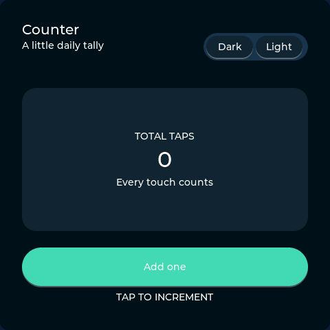
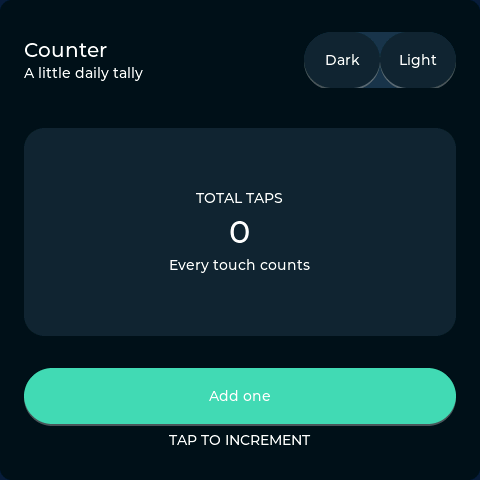
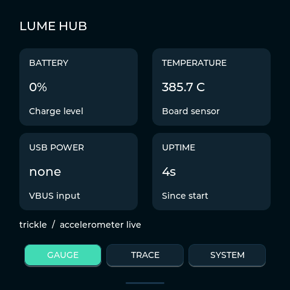
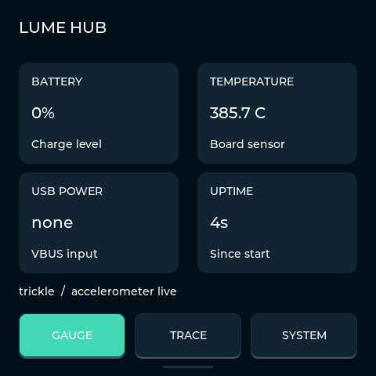
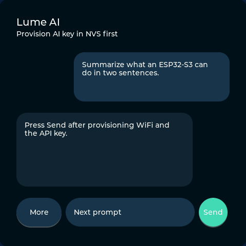
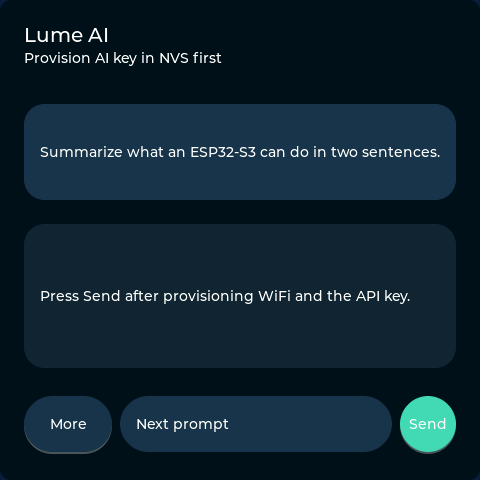

# r41b — UI alignment and centering

Baseline: `f9cd335` on `main`; `git fetch origin`, `git status --short`, and `git log -1 --oneline` were checked before editing. Git author identity: `congduan <congduan@users.noreply.github.com>`.

The ten refreshed example captures use a 24 px outer gutter. Peer cards and main buttons share the same visible width. Header pairs use the same vertical center, visible card content is centered within the configured card, and configured gaps use 4/8/12/16/24/32 px. Rendered block bounds and detailed checks are below. `runtime/shell.js` also uses the gutter and 56 px touch targets for its visible controls.

## Pixel assertions

Command: `python3 tools/emu/check_layout.py --all tools/emu/layout_expectations.json`. Exit code: 0. PNGs are 480×480 frames from the current firmware under esp32sim. The JSON contract names visible blocks and scan regions. Solid fills match screenshot RGB565 values; sample and edge modes cover close colored surfaces. `PASS` means every configured applicable assertion passed. R3 applies where a header has a paired control; R4 applies to visible text groups inside cards. Empty cases are vacuous.

```text
app                  R1    R2    R3    R4    R5    R6    R7
counter              PASS  PASS  PASS  PASS  PASS  PASS  PASS 
power_demo           PASS  PASS  PASS  PASS  PASS  PASS  PASS 
imu_poll             PASS  PASS  PASS  PASS  PASS  PASS  PASS 
heart_curve          PASS  PASS  PASS  PASS  PASS  PASS  PASS 
dashboard            PASS  PASS  PASS  PASS  PASS  PASS  PASS 
device_monitor       PASS  PASS  PASS  PASS  PASS  PASS  PASS 
files                PASS  PASS  PASS  PASS  PASS  PASS  PASS 
file_manager         PASS  PASS  PASS  PASS  PASS  PASS  PASS 
ai_chat              PASS  PASS  PASS  PASS  PASS  PASS  PASS 
music_player         PASS  PASS  PASS  PASS  PASS  PASS  PASS
```

## Before and after

The before images were regenerated from `git show f9cd335:examples/<app>/app.js` with the same firmware image and simulator settings as the after images. These are captured app states, not mockups.

| App | Before (`f9cd335`) | After (r41b) |
|:--|:--:|:--:|
| Counter |  |  |
| Dashboard |  |  |
| AI chat |  |  |

All ten after PNGs are in `artifacts/emu/ui-refresh/` and are linked from the README screenshot gallery. Each `tools/emu/run.sh` invocation reported a successful second `app eval ok` after `engine recv RELOAD` and exported a nonempty PNG.

## Scope and limitations

Only `examples/`, `runtime/shell.js`, the screenshot checker, screenshots, README, and reports changed. `git diff -- firmware/` produced no output. No prelude primitive or bridge ABI change was needed; existing JS style attributes `alignItems`, `justifyContent`, `translateY`, and padding were sufficient. Interaction handlers and data logic remain unchanged. Host emulator rendering does not establish physical display clipping, touch feel, audio, TF media, or power acceptance. The checker verifies the configured visible blocks in the captured default state; dynamic dialog and library states still need separate visual acceptance.

## Raw verification output

<details><summary>check_layout.py: all block bounds and assertions</summary>

```text

counter: artifacts/emu/ui-refresh/counter.png
  card               bbox=[24, 128, 456, 336]
  button             bbox=[24, 368, 456, 424]
  content            bbox=[170, 193, 310, 273]
  title              bbox=[25, 43, 107, 52]
  caption            bbox=[24, 52, 143, 81]
  heading            bbox=[24, 43, 143, 81]
  toggle             bbox=[304, 32, 456, 88]
  PASS R1 card.left: 24 expected 24 ±1
  PASS R1 card.right: 456 expected 456 ±1
  PASS R1 button.left: 24 expected 24 ±1
  PASS R1 button.right: 456 expected 456 ±1
  PASS R2 ['card', 'button']: widths [432, 432]
  PASS R3 heading/toggle centerY: 62.0 expected 60.0 ±2
  PASS R4 card/content: top=65 bottom=63 difference=2
  PASS R5 card/button: vertical gap 32
  PASS R6 button: height 56 >= 56
  PASS R6 button: screen inset >= 24
  PASS R6 toggle: height 56 >= 56
  PASS R6 toggle: screen inset >= 24
  PASS R7 ['title', 'caption']: ink left edges [25, 24]

power_demo: artifacts/emu/ui-refresh/power_demo.png
  card               bbox=[24, 112, 456, 336]
  button             bbox=[24, 360, 456, 416]
  content            bbox=[181, 185, 298, 262]
  title              bbox=[26, 28, 88, 42]
  caption            bbox=[24, 52, 186, 66]
  PASS R1 card.left: 24 expected 24 ±1
  PASS R1 card.right: 456 expected 456 ±1
  PASS R1 button.left: 24 expected 24 ±1
  PASS R1 button.right: 456 expected 456 ±1
  PASS R2 ['card', 'button']: widths [432, 432]
  PASS R4 card/content: top=73 bottom=74 difference=1
  PASS R5 card/button: vertical gap 24
  PASS R6 button: height 56 >= 56
  PASS R6 button: screen inset >= 24
  PASS R7 ['title', 'caption']: ink left edges [26, 24]

imu_poll: artifacts/emu/ui-refresh/imu_poll.png
  x                  bbox=[24, 120, 160, 248]
  y                  bbox=[172, 120, 308, 248]
  z                  bbox=[320, 120, 456, 248]
  button             bbox=[24, 360, 456, 416]
  x_text             bbox=[36, 161, 101, 207]
  y_text             bbox=[184, 161, 249, 207]
  z_text             bbox=[332, 161, 397, 207]
  title              bbox=[26, 27, 95, 42]
  caption            bbox=[25, 52, 163, 63]
  status             bbox=[24, 264, 456, 328]
  PASS R1 button.left: 24 expected 24 ±1
  PASS R1 button.right: 456 expected 456 ±1
  PASS R1 status.left: 24 expected 24 ±1
  PASS R1 status.right: 456 expected 456 ±1
  PASS R1 x.left: 24 expected 24 ±1
  PASS R1 z.right: 456 expected 456 ±1
  PASS R5 ['x', 'y', 'z']: horizontal gap 12
  PASS R5 ['x', 'y', 'z']: horizontal gap 12
  PASS R4 x/x_text: top=41 bottom=41 difference=0
  PASS R4 y/y_text: top=41 bottom=41 difference=0
  PASS R4 z/z_text: top=41 bottom=41 difference=0
  PASS R5 x/status: vertical gap 16
  PASS R5 status/button: vertical gap 32
  PASS R6 button: height 56 >= 56
  PASS R6 button: screen inset >= 24
  PASS R7 ['title', 'caption']: ink left edges [26, 25]

heart_curve: artifacts/emu/ui-refresh/heart_curve.png
  card               bbox=[24, 112, 456, 376]
  button             bbox=[24, 400, 456, 456]
  title              bbox=[26, 28, 143, 42]
  caption            bbox=[24, 52, 142, 66]
  PASS R1 card.left: 24 expected 24 ±1
  PASS R1 card.right: 456 expected 456 ±1
  PASS R1 button.left: 24 expected 24 ±1
  PASS R1 button.right: 456 expected 456 ±1
  PASS R2 ['card', 'button']: widths [432, 432]
  PASS R5 card/button: vertical gap 24
  PASS R6 button: height 56 >= 56
  PASS R6 button: screen inset >= 24
  PASS R7 ['title', 'caption']: ink left edges [26, 24]

dashboard: artifacts/emu/ui-refresh/dashboard.png
  a                  bbox=[24, 80, 228, 209]
  b                  bbox=[252, 80, 456, 209]
  c                  bbox=[24, 220, 228, 349]
  d                  bbox=[252, 220, 456, 349]
  tab1               bbox=[24, 400, 160, 456]
  tab2               bbox=[172, 400, 308, 456]
  tab3               bbox=[320, 400, 456, 456]
  a_text             bbox=[40, 99, 129, 192]
  b_text             bbox=[268, 99, 375, 189]
  c_text             bbox=[40, 239, 131, 332]
  d_text             bbox=[268, 239, 345, 329]
  PASS R1 a.left: 24 expected 24 ±1
  PASS R1 b.right: 456 expected 456 ±1
  PASS R5 ['a', 'b']: horizontal gap 24
  PASS R1 c.left: 24 expected 24 ±1
  PASS R1 d.right: 456 expected 456 ±1
  PASS R5 ['c', 'd']: horizontal gap 24
  PASS R1 tab1.left: 24 expected 24 ±1
  PASS R1 tab3.right: 456 expected 456 ±1
  PASS R5 ['tab1', 'tab2', 'tab3']: horizontal gap 12
  PASS R5 ['tab1', 'tab2', 'tab3']: horizontal gap 12
  PASS R2 ['a', 'b', 'c', 'd']: widths [204, 204, 204, 204]
  PASS R4 a/a_text: top=19 bottom=17 difference=2
  PASS R4 b/b_text: top=19 bottom=20 difference=1
  PASS R4 c/c_text: top=19 bottom=17 difference=2
  PASS R4 d/d_text: top=19 bottom=20 difference=1
  PASS R5 a/c: vertical gap 11
  PASS R5 b/d: vertical gap 11
  PASS R6 tab1: height 56 >= 56
  PASS R6 tab1: screen inset >= 24
  PASS R6 tab2: height 56 >= 56
  PASS R6 tab2: screen inset >= 24
  PASS R6 tab3: height 56 >= 56
  PASS R6 tab3: screen inset >= 24

device_monitor: artifacts/emu/ui-refresh/device_monitor.png
  a                  bbox=[24, 88, 228, 215]
  b                  bbox=[252, 88, 456, 215]
  c                  bbox=[24, 240, 228, 367]
  d                  bbox=[252, 240, 456, 367]
  footer             bbox=[24, 392, 456, 448]
  a_text             bbox=[41, 107, 135, 195]
  b_text             bbox=[268, 107, 375, 195]
  c_text             bbox=[41, 259, 157, 347]
  d_text             bbox=[268, 258, 374, 347]
  heading            bbox=[26, 36, 93, 51]
  right              bbox=[383, 36, 456, 50]
  PASS R1 footer.left: 24 expected 24 ±1
  PASS R1 footer.right: 456 expected 456 ±1
  PASS R1 a.left: 24 expected 24 ±1
  PASS R1 b.right: 456 expected 456 ±1
  PASS R5 ['a', 'b']: horizontal gap 24
  PASS R1 c.left: 24 expected 24 ±1
  PASS R1 d.right: 456 expected 456 ±1
  PASS R5 ['c', 'd']: horizontal gap 24
  PASS R2 ['a', 'b', 'c', 'd']: widths [204, 204, 204, 204]
  PASS R3 heading/right centerY: 43.5 expected 43.0 ±2
  PASS R4 a/a_text: top=19 bottom=20 difference=1
  PASS R4 b/b_text: top=19 bottom=20 difference=1
  PASS R4 c/c_text: top=19 bottom=20 difference=1
  PASS R4 d/d_text: top=18 bottom=20 difference=2
  PASS R5 a/c: vertical gap 25
  PASS R5 c/footer: vertical gap 25

files: artifacts/emu/ui-refresh/files.png
  header             bbox=[24, 24, 456, 80]
  list               bbox=[24, 92, 456, 364]
  button             bbox=[24, 376, 456, 432]
  back               bbox=[36, 24, 92, 80]
  row_delete         bbox=[147, 104, 203, 160]
  PASS R1 header.left: 24 expected 24 ±1
  PASS R1 header.right: 456 expected 456 ±1
  PASS R1 list.left: 24 expected 24 ±1
  PASS R1 list.right: 456 expected 456 ±1
  PASS R1 button.left: 24 expected 24 ±1
  PASS R1 button.right: 456 expected 456 ±1
  PASS R2 ['header', 'list', 'button']: widths [432, 432, 432]
  PASS R5 header/list: vertical gap 12
  PASS R5 list/button: vertical gap 12
  PASS R6 button: height 56 >= 56
  PASS R6 button: screen inset >= 24
  PASS R6 back: height 56 >= 56
  PASS R6 back: screen inset >= 24
  PASS R6 row_delete: height 56 >= 56
  PASS R6 row_delete: screen inset >= 24

file_manager: artifacts/emu/ui-refresh/file_manager.png
  header             bbox=[24, 24, 456, 72]
  list               bbox=[24, 88, 456, 360]
  up                 bbox=[24, 392, 123, 448]
  new                bbox=[135, 392, 234, 448]
  del                bbox=[246, 392, 345, 448]
  view               bbox=[357, 392, 456, 448]
  heading            bbox=[34, 40, 85, 54]
  right              bbox=[379, 42, 446, 53]
  row_delete         bbox=[327, 89, 387, 145]
  PASS R1 header.left: 24 expected 24 ±1
  PASS R1 header.right: 456 expected 456 ±1
  PASS R1 list.left: 24 expected 24 ±1
  PASS R1 list.right: 456 expected 456 ±1
  PASS R1 up.left: 24 expected 24 ±1
  PASS R1 view.right: 456 expected 456 ±1
  PASS R5 ['up', 'new', 'del', 'view']: horizontal gap 12
  PASS R5 ['up', 'new', 'del', 'view']: horizontal gap 12
  PASS R5 ['up', 'new', 'del', 'view']: horizontal gap 12
  PASS R2 ['header', 'list']: widths [432, 432]
  PASS R2 ['up', 'new', 'del', 'view']: widths [99, 99, 99, 99]
  PASS R3 heading/right centerY: 47.0 expected 47.5 ±2
  PASS R5 header/list: vertical gap 16
  PASS R6 up: height 56 >= 56
  PASS R6 up: screen inset >= 24
  PASS R6 new: height 56 >= 56
  PASS R6 new: screen inset >= 24
  PASS R6 del: height 56 >= 56
  PASS R6 del: screen inset >= 24
  PASS R6 view: height 56 >= 56
  PASS R6 view: screen inset >= 24
  PASS R6 row_delete: height 56 >= 56
  PASS R6 row_delete: screen inset >= 24

ai_chat: artifacts/emu/ui-refresh/ai_chat.png
  question           bbox=[24, 104, 456, 200]
  answer             bbox=[24, 224, 456, 368]
  more               bbox=[24, 396, 112, 452]
  prompt             bbox=[120, 396, 392, 452]
  send               bbox=[400, 396, 456, 452]
  q_text             bbox=[40, 146, 440, 157]
  a_text             bbox=[41, 290, 410, 304]
  title              bbox=[26, 28, 108, 42]
  caption            bbox=[25, 52, 222, 66]
  PASS R1 question.left: 24 expected 24 ±1
  PASS R1 question.right: 456 expected 456 ±1
  PASS R1 answer.left: 24 expected 24 ±1
  PASS R1 answer.right: 456 expected 456 ±1
  PASS R1 more.left: 24 expected 24 ±1
  PASS R1 send.right: 456 expected 456 ±1
  PASS R5 ['more', 'prompt', 'send']: horizontal gap 8
  PASS R5 ['more', 'prompt', 'send']: horizontal gap 8
  PASS R2 ['question', 'answer']: widths [432, 432]
  PASS R4 question/q_text: top=42 bottom=43 difference=1
  PASS R4 answer/a_text: top=66 bottom=64 difference=2
  PASS R5 question/answer: vertical gap 24
  PASS R6 more: height 56 >= 56
  PASS R6 more: screen inset >= 24
  PASS R6 send: height 56 >= 56
  PASS R6 send: screen inset >= 24
  PASS R7 ['title', 'caption']: ink left edges [26, 25]

music_player: artifacts/emu/ui-refresh/music_player.png
  card               bbox=[24, 152, 456, 272]
  progress           bbox=[24, 280, 456, 288]
  library            bbox=[360, 24, 456, 80]
  label              bbox=[25, 46, 128, 56]
  line               bbox=[173, 204, 307, 219]
  prev               bbox=[96, 336, 168, 392]
  pause              bbox=[196, 336, 284, 392]
  next               bbox=[312, 336, 384, 392]
  vol1               bbox=[24, 400, 88, 456]
  vol2               bbox=[96, 400, 160, 456]
  vol3               bbox=[320, 400, 384, 456]
  vol4               bbox=[392, 400, 456, 456]
  PASS R1 card.left: 24 expected 24 ±1
  PASS R1 card.right: 456 expected 456 ±1
  PASS R1 progress.left: 24 expected 24 ±1
  PASS R1 progress.right: 456 expected 456 ±1
  PASS R1 vol1.left: 24 expected 24 ±1
  PASS R1 vol4.right: 456 expected 456 ±1
  PASS R2 ['card', 'progress']: widths [432, 432]
  PASS R3 label/library centerY: 51.0 expected 52.0 ±2
  PASS R4 card/line: top=52 bottom=53 difference=1
  PASS R5 card/progress: vertical gap 8
  PASS R6 library: height 56 >= 56
  PASS R6 library: screen inset >= 24
  PASS R6 prev: height 56 >= 56
  PASS R6 prev: screen inset >= 24
  PASS R6 pause: height 56 >= 56
  PASS R6 pause: screen inset >= 24
  PASS R6 next: height 56 >= 56
  PASS R6 next: screen inset >= 24
  PASS R6 vol1: height 56 >= 56
  PASS R6 vol1: screen inset >= 24
  PASS R6 vol2: height 56 >= 56
  PASS R6 vol2: screen inset >= 24
  PASS R6 vol3: height 56 >= 56
  PASS R6 vol3: screen inset >= 24
  PASS R6 vol4: height 56 >= 56
  PASS R6 vol4: screen inset >= 24

app                  R1    R2    R3    R4    R5    R6    R7
counter              PASS  PASS  PASS  PASS  PASS  PASS  PASS 
power_demo           PASS  PASS  PASS  PASS  PASS  PASS  PASS 
imu_poll             PASS  PASS  PASS  PASS  PASS  PASS  PASS 
heart_curve          PASS  PASS  PASS  PASS  PASS  PASS  PASS 
dashboard            PASS  PASS  PASS  PASS  PASS  PASS  PASS 
device_monitor       PASS  PASS  PASS  PASS  PASS  PASS  PASS 
files                PASS  PASS  PASS  PASS  PASS  PASS  PASS 
file_manager         PASS  PASS  PASS  PASS  PASS  PASS  PASS 
ai_chat              PASS  PASS  PASS  PASS  PASS  PASS  PASS 
music_player         PASS  PASS  PASS  PASS  PASS  PASS  PASS
```

</details>

<details><summary>21 JS harnesses: raw output</summary>

```text
===== tests/ai.js =====
request construction + key storage: PASS
HTTP error + timeout + bad JSON + truncation: PASS
Node local POST round trip: PASS
===== tests/animation_mapping.js =====
PASS initial transition value uses SET_ATTR
PASS transition signal.set emits ANIMATE with omitted from and ease-out
PASS ANIMATE_CANCEL path
PASS onComplete registered and dispatched through reverse event hook
PASS same-property replacement discards old completion
PASS color animation rejected
===== tests/apps.js =====
PASS apps entries merges meta.json and falls back per field
PASS apps entries tolerates a store without native metadata
PASS apps entries ignores malformed meta instead of throwing
PASS apps current() reports the running app id
PASS apps launch/home/remove return the native status codes
PASS apps Launcher defaults to the installed app set
PASS apps Launcher tap launches the app by default (no host callback)
PASS apps explicit apps + onLaunch still override the store
PASS apps Launcher rejects a non-array app list
PASS apps embedded home renders a clock and one tile per installed app
PASS apps embedded home launches a tile and keeps BACK at the root
PASS apps embedded home shows an empty state with no apps
PASS 12 multi-app cases
===== tests/ble.js =====
PASS lume.ble wiring (header, CMake, sdkconfig, natives, types, docs)
PASS onStart advertises; first poll of a live link sends HELLO
PASS poll drains one RX packet, verifies the link and acks it
PASS Ping Button press sends a ping
PASS Ping counter Text reflects the press
PASS negative read() status is handled by the app
PASS onPause / shutdown stops advertising
PASS failed start() is surfaced without starting the poll timer
===== tests/canvas_mapping.js =====
PASS canvas create dimensions and fixed wire kind
PASS drawing command order and final invalidate
PASS optional dirty rectangles preserve local coordinates
PASS signal change redraws once; equal value stays idle
PASS canvas is adopted into flex layout flow at fixed size
PASS dimensions/coordinates/color/text/point bounds reject
PASS injected 390x390 screen governs canvas size, budget and draw bounds
PASS counter example retains count and theme behavior
SAMPLE messages (first 12): [["create",1,0],["attr",1,12,12],["attr",1,0,"taps: 0"],["create",0,0],["attr",2,1,2377581],["attr",2,16,100],["attr",2,3,120],["attr",2,7,1],["attr",2,8,2],["attr",2,9,2],["attr",2,11,6],["attr",2,12,12]]
SAMPLE totals: {"create":7,"attr":42,"press":3}
PASS 33 contiguous lines split at 32
CANVAS 240 points: old=239 messages / 27724 queue bytes; new=8 messages / 928 queue bytes + 3824 payload bytes
PASS 240-point polyline uses eight batches
===== tests/create_failure.js =====
PASS: create-failed notice disposes signal effects and warns once
PASS: Canvas failure latches dead id and native attrs become no-op
===== tests/files_dialog.js =====
PASS files before: DEL -> status confirmation -> DEL -> remove
PASS files after: DEL -> Dialog -> Delete -> remove -> Toast
===== tests/games.js =====
PASS 2048 left
PASS 2048 right
PASS 2048 up
PASS 2048 down
PASS 2048 no change
PASS 2048 game over
PASS snake turns
PASS snake eats
PASS snake wall
PASS snake body
PASS snake IMU threshold
PASS 2048 high score KV key
PASS snake high score KV key
PASS brkout high score KV key
PASS breakout wall rebound
PASS breakout brick
PASS breakout level
PASS breakout game over
===== tests/gesture_queue.js =====
PASS: DOWN MOVE UP retain FIFO order
PASS: MOVE pressure reserves capacity and UP reaches queue tail
===== tests/gestures.js =====
PASS tap: short press with small displacement -> one tap with end coords
PASS tap boundary: displacement >= tapMovePx(10) is NOT a tap
PASS tap boundary: duration >= tapMaxMs(400) is NOT a tap (becomes longpress)
PASS longpress boundary: fires while still down once t-start >= 400ms
PASS longpress suppresses tap AND swipe on release (no double-fire)
EVIDENCE pan stream types=["panstart","pan","pan","panend"] final dx/dy=35/2
PASS pan stream: panstart -> pan* -> panend, with dx/dy from press start
PASS swipe: LVGL gesture-dir hint (right=2) wins over axis inference
PASS swipe: axis fallback when no LVGL dir hint (vertical -> down)
PASS swipe speed gate: a 5s STATIONARY hold is a longpress, never a swipe
PASS r21-fix: a SLOW drag held past 400ms is pan, NEVER longpress (movement gate)
PASS r21-fix: a slow drag that ends fast stays swipe-eligible (no longpress steal)
PASS r21-fix: slow long drag (dist>=50px, vel<min) is neither longpress nor swipe
PASS swipeMinVel is a real, tunable gate (raise it -> slow drag stops swiping)
PASS scroll-cancelled UP: a List scroll wins, no tap/swipe/longpress
PASS tuning is centralized and tunable: swipeMinPx can be raised at runtime
PASS on() enables LVGL events once per node and rejects bad type/callback
PASS  dispatched GestureEvent reaches the right callback with coordinates
PASS unregister function is idempotent and stops future delivery
PASS longpress then release: no tap delivered; onPress (CLICKED) suppressed
PASS normal tap: onPress AND gesture tap both fire (no longpress latch)
PASS dispose clears per-node gesture state (removed node stops dispatching)
EVIDENCE demo tap -> status="tap (61,100)" taps=1
PASS examples/gestures/app.js evaluates and its tap counter responds
PASS example swipe changes page and longpress toggles color
PASS 20 r21 gesture cases
===== tests/image_mapping.js =====
PASS Image create/source/size message order
PASS Image participates in View flex child adoption
PASS Image preserves aspect ratio for one explicit dimension
PASS Image propagates decoder error and removes failed node
PASS Image rejects invalid input and propagates header error
PASS embedded PNG 1x1 decodes to exact opaque red RGBA bytes
===== tests/imu_ball.js =====
PASS imu_ball gravity accelerates and displaces
PASS imu_ball wall reflects normal velocity with restitution
PASS imu_ball hole event
PASS imu_ball goal requires entire ball inside
PASS imu_ball boundary clamps and reflects
PASS imu_ball dt cap limits delayed tick
PASS imu_ball resting contact has no sound impact
===== tests/lifecycle.js =====
PASS registration, unregistration and start/pause/resume sequence
PASS onBack unregistered selects default
PASS onBack false selects default
PASS onBack true intercepts
PASS timeout once and interval skips missed periods
PASS timer clear is idempotent
PASS paused timer waits and resumes without catch-up burst
PASS hot replacement disposes effect, canvas onDraw, animation and timer
PASS shutdown clears lifecycle and timer registries
PASS replacement starts fresh app without old callbacks
===== tests/list_virtualization.js =====
EVIDENCE 1000 items / 12 visible: actual created nodes=17 (15 rows + container + spacer)
PASS 1000 items, 12 visible: initial 15 rows, 17 total nodes
EVIDENCE 1000 items / 12 visible: middle window live nodes=20 (18 rows + 2 fixed)
PASS scroll maps to 18-row middle window
PASS scroll window reclaims old rows before creating replacements
PASS small scroll within same window does not churn nodes
PASS same-length items replacement rebuilds window and keeps offset
PASS length change rebuilds and resets scroll to top
PASS removed row loses press callback and signal effects
PASS 1000-item traversal stays within the 127-node table
PASS bridge throttle and overflow policy are present
EVIDENCE files seedTestEntries(): 1000 entries, 40 new nodes
PASS files example seeds 1000 entries without creating 1000 rows
PASS 10 list virtualization cases
===== tests/music_player.js =====
LRC normal: PASS
LRC skip untimed: PASS
LRC sort: PASS
LRC bad GBK bytes: PASS
Scheduler: ticks=7 decoded=5 sent=4 retry=2 PASS
Scheduler: stop and negative-index wrap PASS
Lyrics: five-line window and missing LRC PASS
Library: recursive scan, ID3 title order, last track and offset KV PASS
Restart: last track and LRC offset restored, playback starts at zero PASS
===== tests/power.js =====
PASS wake registration, unregister, and success-only dispatch
PASS touch feeds idle timer and wake resets activity
PASS shutdown clears wake callbacks
===== tests/reload_staging.js =====
PASS: A post failure frees only A; B posts latest frame with pending set
PASS: successful post coalesces replacement and preserves latest frame
===== tests/shell_components.js =====
PASS shell Card and IconButton expose watch-sized defaults
PASS shell StatusBar getter follows signal
PASS shell StatusBar clock timer and disposal
PASS shell EdgeNavigation true handles back
PASS shell EdgeNavigation false forwards page swipe
PASS shell indicator draws and rebounds, mask toggles
PASS shell Launcher creates bounded virtual grid
PASS shell app press and edge gesture route independently
PASS shell dispose unregisters gestures and app close clears resources
PASS shell spacing injects missing View padding and gap and follows theme changes
PASS shell explicit spacing wins and invalid token is atomic
PASS shell Dialog opens and close is idempotent
PASS shell Dialog stack ignores covered button and closes top first
PASS shell Dialog lifecycle pause removes overlays
PASS shell danger button follows theme danger token
PASS shell primary button follows theme primary token
PASS shell Toast replaces current and resets timer
PASS shell Toast fades then removes itself
PASS 18 shell component cases
===== tests/style_mapping.js =====
PASS column + dimensions + color: [[1,728639],[16,100],[17,50],[7,1]]
PASS row: [[7,0]]
PASS row wrap: [[7,2]]
PASS column wrap: [[7,3]]
PASS justify start: [[8,0]]
PASS justify end: [[8,1]]
PASS justify center: [[8,2]]
PASS justify space-between: [[8,3]]
PASS justify space-around: [[8,4]]
PASS justify space-evenly: [[8,5]]
PASS stretch + gap + padding: [[9,3],[10,16],[11,8]]
PASS radius + border + opacity: [[12,12],[13,2],[14,11259375],[15,128]]
PASS pixel + legacy bg: [[1,1122867],[2,240],[3,120]]
PASS vertical scroll + auto scrollbar: [[20,1],[21,1]]
PASS horizontal scroll + on scrollbar: [[20,2],[21,2]]
PASS scroll disabled + scrollbar off: [[20,0],[21,0]]
PASS per-side padding overrides box shorthand: [[10,8],[30,2],[31,4],[32,6],[33,10]]
PASS margin box + per-side margin: [[34,4],[38,12]]
PASS margin sides only: [[35,2],[36,3],[37,5],[38,7]]
PASS flex grow inside a flex row: [[7,0],[39,1]]
PASS auto sizing: [[43,1],[44,1]]
PASS min/max size bounds: [[45,10],[46,200],[47,20],[48,40]]
PASS absolute position escapes the flow: [[23,1],[18,4],[19,8]]
PASS relative position sends nothing: []
PASS translate px + percent: [[49,6],[52,50]]
PASS text align + long mode: [[53,1],[54,1]]
PASS align string + alignTo + alignOffset: [[40,5],[41,-8],[42,-4],[4,6]]
PASS align center: [[4,0]]
PASS align top-left: [[4,1]]
PASS align top-mid: [[4,2]]
PASS align top-right: [[4,3]]
PASS align bottom-mid: [[4,4]]
PASS align bottom-left: [[4,5]]
PASS align bottom-right: [[4,6]]
PASS align left-mid: [[4,7]]
PASS align right-mid: [[4,8]]
PASS align numeric constant: [[4,4]]
PASS aligned to parent with an offset: [[40,0],[42,12],[4,2]]
PASS outside align below a base node: [[40,7],[4,13]]
PASS outside align above a base node: [[40,7],[4,10]]
PASS outside align right of a base node: [[40,7],[4,19]]
PASS outside align corner: [[40,7],[41,4],[4,18]]
PASS outside align numeric constant: [[4,20]]
PASS invalid align/alignTo/alignOffset/flexGrow/margin/position/translate/text rejected in prelude
PASS Row presets flex row: [[7,0]]
PASS Column presets flex column: [[16,100],[7,1]]
PASS fontSize/letterSpacing/lineHeight: [[55,20],[56,1],[57,-2]]
PASS fontSize snaps + scales via theme.fontScale: [[55,18]]
PASS fontScale below 1 keeps faces in range: [[55,22]]
PASS invalid percentage/metric/color/opacity rejected in prelude
PASS all style mapping cases
PASS embedded demo and refreshed counter both register buttons
===== tests/text_payload.js =====
PASS: 240-byte Chinese and 256-byte ASCII text accepted; 257 bytes rejected
PASS: external text payload has sender rollback and receiver release paths
===== tests/theme_mapping.js =====
PASS set/get returns an isolated snapshot
PASS named background and borderColor resolve
PASS hex literals remain valid
dark→light ATTR messages: [[1,1,15332090],[1,12,16],[1,14,2310751]]
PASS theme.set invalidates every named color and implicit radius
PASS unreferenced literal colors and explicit radius post no messages
PASS removing default radius clears inherited radius
PASS invalid theme is atomic
PASS disposed node stops receiving theme updates
PASS unknown token falls through to literal parser
demo dark→light ATTR messages: [[2,1,16777215],[7,1,15332090]]
PASS demo buttons recolor card, controls and full-screen root
```

</details>

<details><summary>CLI unit tests: raw output</summary>

```text

> @lume/cli@0.1.0 test
> node --test

TAP version 13
# Subtest: frame bytes match firmware wire layout and CRC-32
ok 1 - frame bytes match firmware wire layout and CRC-32
  ---
  duration_ms: 3.322967
  type: 'test'
  ...
# Subtest: create writes complete offline scaffold and bundles with prelude globals
ok 2 - create writes complete offline scaffold and bundles with prelude globals
  ---
  duration_ms: 36.7178
  type: 'test'
  ...
# Subtest: esbuild iife runs in global-script host; esm syntax does not
ok 3 - esbuild iife runs in global-script host; esm syntax does not
  ---
  duration_ms: 9.395835
  type: 'test'
  ...
# Subtest: bundle rejects oversize output before opening serial
ok 4 - bundle rejects oversize output before opening serial
  ---
  duration_ms: 17.397339
  type: 'test'
  ...
# Subtest: OTA auth preamble + default port match the firmware wire format
ok 5 - OTA auth preamble + default port match the firmware wire format
  ---
  duration_ms: 0.456058
  type: 'test'
  ...
# Subtest: OTA push reuses the USB frame() bytes (right-token path)
ok 6 - OTA push reuses the USB frame() bytes (right-token path)
  ---
  duration_ms: 14.319861
  type: 'test'
  ...
# Subtest: OTA wrong token is rejected (AUTH ERR path)
ok 7 - OTA wrong token is rejected (AUTH ERR path)
  ---
  duration_ms: 4.356034
  type: 'test'
  ...
# Subtest: OTA screenshot round trips the RGB565 frame past log noise
ok 8 - OTA screenshot round trips the RGB565 frame past log noise
  ---
  duration_ms: 44.298681
  type: 'test'
  ...
# Subtest: decodeShot rejects a corrupted payload and a CRC mismatch
ok 9 - decodeShot rejects a corrupted payload and a CRC mismatch
  ---
  duration_ms: 0.99453
  type: 'test'
  ...
# Subtest: bmpFromRgb565 produces a valid bottom-up 24-bit BMP
ok 10 - bmpFromRgb565 produces a valid bottom-up 24-bit BMP
  ---
  duration_ms: 0.824476
  type: 'test'
  ...
# Subtest: OTA RELOAD ERR is surfaced as a push error
ok 11 - OTA RELOAD ERR is surfaced as a push error
  ---
  duration_ms: 7.524209
  type: 'test'
  ...
# Subtest: command frame uses LUMC magic, same header and CRC as app frames
ok 12 - command frame uses LUMC magic, same header and CRC as app frames
  ---
  duration_ms: 0.367884
  type: 'test'
  ...
# Subtest: STORE payload layout: verb, id, one-line meta, then raw source
ok 13 - STORE payload layout: verb, id, one-line meta, then raw source
  ---
  duration_ms: 0.30072
  type: 'test'
  ...
# Subtest: OTA command round trip: STORE + LIST + LAUNCH ACKs
ok 14 - OTA command round trip: STORE + LIST + LAUNCH ACKs
  ---
  duration_ms: 5.950827
  type: 'test'
  ...
# Subtest: CLI apps usage, sub-command and id validation
ok 15 - CLI apps usage, sub-command and id validation
  ---
  duration_ms: 629.548572
  type: 'test'
  ...
# Subtest: OTA no-board path: connection refused is a clear error
ok 16 - OTA no-board path: connection refused is a clear error
  ---
  duration_ms: 2.257157
  type: 'test'
  ...
# Subtest: CLI --ota usage, arg validation and no-board error output
ok 17 - CLI --ota usage, arg validation and no-board error output
  ---
  duration_ms: 452.205496
  type: 'test'
  ...
1..17
# tests 17
# suites 0
# pass 17
# fail 0
# cancelled 0
# skipped 0
# todo 0
# duration_ms 1359.611643
```

</details>
